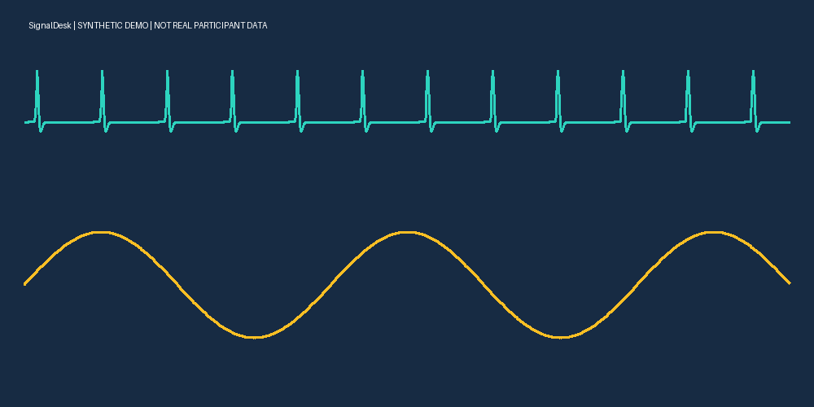

# SignalDesk · 数据集查看器

本地查看生理波形、情绪标签和图片的 Windows 桌面工具。文件内容在本机读取，不上传数据。

## 下载即用（Windows 10/11，64 位）

1. 在本仓库 Releases 下载 `SignalDesk-v1.0.0-windows-x64.zip`。
2. **完整解压**，打开 SignalDesk 文件夹，双击 `SignalDesk.exe`，无需安装 Python。
3. 首次打开显示内置合成波形和标签。点击“选择数据集文件夹”，双击文件查看自己的数据。

请保留 EXE 旁的 `_internal` 文件夹。配置和日志位于 `%LOCALAPPDATA%\SignalDesk`。此初始版本未代码签名，发布页提供 SHA256 校验值。

## 功能

- 文件夹浏览、文件名搜索、手动选择文件。
- CSV/TSV/TXT、NPY/NPZ、数值 MAT、HDF5、PCM WAV 波形；变量、通道、时间单位及采样率选择。
- 多通道绘图、缩放、平移、拖选时间区间、标准化显示、统计、原始数值 CSV 区间导出、PNG 绘图导出。
- 文本文件分页读取，默认每页 20 万行；绘图降采样保留局部极值。
- CASE 标准目录自动匹配生理波形与 valence/arousal 标签。“打开 CASE”手动选择解压目录。
- PNG/JPG/BMP/TIFF/WebP/GIF 图片：适应窗口、原尺寸、缩放、平移、前后翻页。
- 数据表和文件信息，ZIP 只显示目录。



## 使用与限制

没有时间列时默认 1 Hz 只是占位值，必须填写真实采样率。支持秒、毫秒、微秒。表格最多预览 500 行；统计、导出使用当前页完整选中区间，导出原始数值，不受标准化显示影响。

NPZ 和传统 MAT 的选中数组可能完整加载，超大数组建议用 NPY/HDF5。仅支持数值数组，不执行 pickle、PT/PTH；不支持复杂 MATLAB 结构体、压缩音频和视频。多帧图片只显示第一帧。软件不估算心率，不推断情绪，不自动同步跨设备时钟。

内置例子由 make_demo.py 生成，全部是合成信号和合成标签，不能用于研究结论。真实 CASE 数据请从[官方数据页](https://doi.org/10.6084/m9.figshare.8869157.v1)自行下载；此软件不包含真实被试数据。

## 源码运行

使用 Python 3.12（包含 Tk）。

```powershell
python -m venv .venv
.venv\Scripts\python -m pip install -r requirements.txt
.venv\Scripts\python make_demo.py
.venv\Scripts\python app.py
```

## 测试和打包

```powershell
.venv\Scripts\python -m unittest test_readers test_ui
.venv\Scripts\python -m pip install pyinstaller==6.22.3
powershell -ExecutionPolicy Bypass -File build.ps1
```

在 Windows x64 构建。构建脚本运行测试，生成 release 中的 ZIP 和 SHA256。依赖许可证在发行包 `_internal/third-party` 中。软件采用 [MIT](LICENSE) 许可证。
